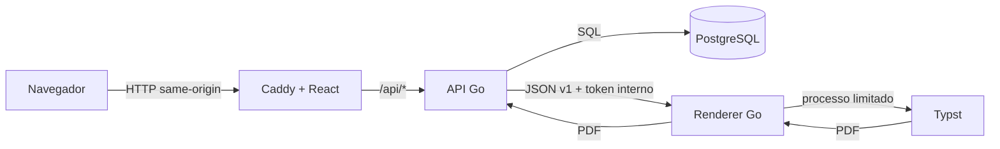

# Arquitetura de fundação

Este documento descreve o walking skeleton do Etpeto. Ele registra decisões confirmadas e deixa explícito o que ainda é direção futura.

## Objetivos

- representar o ETP como dados estruturados, sem depender do formato interno de um editor;
- permitir roteiros diferentes por órgão e elementos especializados no futuro;
- produzir PDF determinístico sem executar entrada do usuário como código;
- funcionar em infraestrutura comum do serviço público;
- manter o repositório legível para pessoas e agentes de IA, com contratos curtos e testes rápidos.

## Topologia

Somente o gateway web publica uma porta. `data` liga API e PostgreSQL; `render` liga API e renderer. O renderer não participa da rede de dados e não recebe configuração do banco. A separação não transforma o produto em microserviços: a API continua um monólito modular, e o segundo processo existe por ser uma fronteira de execução e recursos.

## Modelo documental

O documento canônico é JSON versionado do Etpeto. Lexical é usado apenas dentro de elementos de texto rico; seu estado não é o documento inteiro. Da mesma forma, Typst é um destino de renderização, não o modelo de domínio.

No contrato inicial, a API envia ao renderer `schemaVersion`, revisão do template, título e seções normalizadas. O renderer rejeita versões desconhecidas, limites excedidos e campos inválidos. Entrada do usuário nunca fornece código Typst, caminhos de arquivo ou URLs. Elementos futuros — pesquisa de preços, mapa de riscos, tabelas e anexos — devem entrar como variantes discriminadas e validadas, com migração explícita entre versões.

## Decisões de tecnologia

### Go na API e no renderer

Go oferece binários pequenos, inicialização rápida, biblioteca HTTP madura, concorrência explícita e um modelo operacional simples. A sintaxe regular reduz contexto para revisão humana e por agentes. Não foi escolhido apenas por “usar menos tokens”: segurança, clareza e disponibilidade de profissionais continuam sendo critérios superiores. Java/Spring é comum no serviço público, mas imporia mais memória e estrutura ao primeiro corte; Rust ampliaria o controle, porém elevaria custo de desenvolvimento e revisão sem uma necessidade de segurança de memória que justificasse isso agora.

### React, Lexical e Base UI

React foi escolhido porque Lexical é mantido e integrado nativamente nesse ecossistema. A escolha é localizada na camada web: o modelo documental e a API não dependem de React. Lexical entrega primitivas de edição e nós extensíveis sem obrigar o documento inteiro a adotar seu schema.

Base UI fornece comportamento acessível e componentes sem estilo visual rígido. Tokens CSS próprios produzem a aparência leve, arejada e funcional inspirada em GitHub e Cloudflare. Isso evita o peso visual e a dependência estrutural de um kit completo. Zod valida fronteiras no cliente; React Hook Form cuida de formulários; TanStack Query deverá cuidar de estado remoto. Estado local simples permanece no React até existir evidência de que uma store global é necessária.

### PostgreSQL e SQL explícito

PostgreSQL é maduro, amplamente operado e adequado a transações, JSONB quando necessário e isolamento multi-organização. Migrations Goose são a história do schema. `sqlc` gera código tipado a partir de SQL revisável, sem esconder consultas e custos atrás de um ORM. Redis, broker e mecanismos de busca não entram antes de um requisito medido.

### Typst em processo isolado

Typst produz paginação e tipografia reproduzíveis com templates versionados e tem CLI adequada a containers. Ele não precisa expor HTTPS: o renderer HTTP é privado, e TLS termina no gateway ou na infraestrutura do órgão. O binário é baixado de release oficial durante o build, com versão e SHA-256 fixados. Cada renderização usa diretório temporário, limite de tamanho, timeout e concorrência controlada.

### Bun, Docker Compose e Caddy

Bun reduz o conjunto de ferramentas do frontend ao instalar, testar e executar scripts. `bun.lock` deve ser reproduzível. Docker Compose descreve uma implantação de referência e iguala o smoke local ao da CI; não é uma promessa de orquestrador de produção. Caddy serve o build estático e mantém API same-origin com configuração curta e headers seguros.

## Autenticação

O mecanismo entregue é local: senha protegida por Argon2id, token de sessão aleatório e somente o hash SHA-256 do token persistido. O navegador recebe cookie `__Host-etpeto_session` com `Secure`, `HttpOnly`, `SameSite=Lax` e `Path=/`.

OIDC/Keycloak é uma integração planejada. O fluxo futuro será Authorization Code com PKCE no backend. Depois de validar o provedor, a API associa ou cria a identidade externa e emite a mesma sessão local. Assim, o frontend não armazena access token, e autorização da aplicação não fica acoplada à vida do token do provedor. Uma organização escolherá os métodos permitidos; habilitar login local como fallback será decisão administrativa explícita.

## Desenvolvimento orientado a agentes

O repositório trata documentação e testes como contexto executável:

- `AGENTS.md` aponta para fontes de verdade curtas;
- contratos públicos vivem em tipos, schemas e testes próximos ao código;
- mudanças seguem red, green e refactor;
- `make check`, cobertura e smoke são comandos determinísticos;
- ADRs registram decisões duráveis e alternativas rejeitadas;
- dependências e módulos só entram quando reduzem complexidade total demonstrável.

Agentes aceleram implementação, mas não substituem revisão de ameaça, validação visual, decisão de produto ou responsabilidade do mantenedor.

## Limites do corte atual

Ainda não estão implementados: persistência de ETPs, roteiros configuráveis, elementos especializados, exportação final autenticada, OIDC/Keycloak, controle de acesso por organização, trilha de auditoria e colaboração simultânea. “Colaboração” neste projeto significa inicialmente contribuição ao repositório público, não coedição em tempo real.

Mudanças nesta arquitetura exigem atualização deste documento ou uma ADR em `docs/adr/`.
