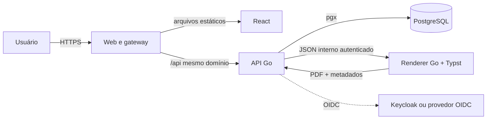

# Etpeto — especificação de produto e arquitetura

**Status:** aprovado para planejamento  
**Data:** 6 de agosto de 2026  
**Primeira versão pública:** `v0.1.0`  
**Licença:** `AGPL-3.0-only`

## 1. Resumo

Etpeto é uma aplicação web open source para elaborar documentos estruturados de planejamento de contratações públicas. O primeiro tipo suportado será o Estudo Técnico Preliminar (ETP), sem acoplar o domínio a um único documento.

O produto substitui a edição manual no Word por um roteiro institucional versionado. O usuário preenche seções e componentes de domínio, enquanto o sistema cuida de estrutura, numeração, sumário, paginação, consistência e geração do PDF com Typst.

O Etpeto será instalável pela própria organização com Docker, PostgreSQL e autenticação local ou OIDC/Keycloak. O repositório público será preparado para contribuições humanas e para desenvolvimento predominante por agentes de IA, com especificações executáveis, TDD, revisão independente e evidências automatizadas.

## 2. Objetivos

O `v0.1` deve permitir que uma organização:

1. instale o Etpeto com containers;
2. autentique usuários localmente, por OIDC ou nos dois modos;
3. personalize e publique um roteiro de ETP;
4. crie, edite, salve e reabra um ETP estruturado;
5. utilize texto rico, tabelas, pesquisa de preços e mapa de riscos;
6. visualize o PDF oficial durante a elaboração;
7. finalize uma revisão imutável e emita um PDF verificável;
8. consulte revisões, emissões e eventos relevantes de auditoria.

O projeto deve favorecer adoção por órgãos públicos, operação simples, contribuições externas e evolução futura para outros documentos de planejamento.

## 3. Não objetivos do `v0.1`

Não fazem parte da primeira versão:

- edição simultânea, CRDT, cursores compartilhados ou presença em tempo real;
- aprovação jurídica, assinatura eletrônica ou certificação legal do documento;
- integrações com SEI, Compras.gov.br ou sistemas equivalentes;
- exportação para DOCX;
- comentários e fluxo editorial entre revisores;
- redação ou preenchimento por IA;
- SaaS com várias organizações na mesma instalação;
- aplicativo móvel nativo;
- mecanismo genérico de formulários capaz de modelar qualquer processo administrativo.

“Finalizado” significa uma revisão congelada pelo Etpeto. Não significa aprovação administrativa, assinatura ou validade jurídica externa.

## 4. Princípios do produto

### 4.1 Documento estruturado, não Word no navegador

O Etpeto possui o documento, suas seções e seus componentes de domínio. Lexical é usado somente dentro das áreas que realmente exigem texto rico. Pesquisa de preços, mapa de riscos, tabelas e metadados são dados estruturados editados por componentes React próprios.

O usuário não controla margens, fontes, quebras manuais ou paginação. Essas decisões pertencem ao template de renderização.

### 4.2 Roteiros institucionais versionados

Um roteiro define:

- título e descrição do tipo de documento;
- ordem, obrigatoriedade e orientação das seções;
- tipos de conteúdo permitidos em cada seção;
- regras de validação aplicáveis;
- template Typst e parâmetros visuais autorizados.

Publicar uma alteração cria uma nova revisão imutável do roteiro. Documentos existentes continuam vinculados à revisão usada na criação. Não existe migração silenciosa de documentos para um roteiro novo.

### 4.3 PDF como prévia oficial

O navegador não implementará um segundo paginador HTML para imitar o Typst. A prévia oficial é o PDF produzido pelo mesmo pipeline usado na exportação final. Durante uma atualização, a interface mantém o último PDF válido visível.

## 5. Experiência do usuário

### 5.1 Direção visual

A interface seguirá uma linguagem “Cloudflare arejada”: superfícies claras, hierarquia suave, espaçamento confortável e alta legibilidade. Base UI fornecerá primitivas sem estilo; a identidade será construída com CSS Modules e tokens próprios.

Laranja será usado de forma contida para ação e orientação, sem copiar a marca Cloudflare. Estados semânticos de sucesso, atenção, erro e informação terão tokens próprios e não dependerão somente de cor.

O nome aparece como **Etpeto** na interface e como `etpeto` em repositório, módulos e imagens de container.

### 5.2 Editor desktop

O espaço de edição possui três painéis:

1. **Roteiro:** seções, ordem, obrigatoriedade e estado de preenchimento;
2. **Editor:** seção ativa e seus elementos estruturados;
3. **Prévia oficial:** PDF Typst da última renderização válida.

Os painéis laterais podem ser recolhidos e redimensionados de forma independente. O editor ocupa o espaço liberado. A última configuração visual é persistida por usuário e dispositivo, sem entrar no conteúdo do documento.

### 5.3 Editor móvel

No celular, roteiro, edição e prévia são modos exclusivos acessados por uma barra inferior. A interface não comprime os três painéis lado a lado. A finalização continua exigindo confirmação explícita.

### 5.4 Estados de salvamento

O cabeçalho sempre apresenta um dos seguintes estados:

- `Salvando…`;
- `Salvo`;
- `Sem conexão — alterações protegidas neste dispositivo`;
- `Falha ao salvar — tentar novamente`;
- `Conflito detectado`.

O autosave usa debounce, mas a aplicação força o envio pendente antes de navegar, finalizar ou exportar. Uma cópia de recuperação por documento permanece no armazenamento local até a confirmação do servidor.

Em conflito, nenhuma versão é sobrescrita silenciosamente. O usuário pode recarregar a revisão remota ou preservar o conteúdo local como uma nova revisão de trabalho.

### 5.5 Telas do `v0.1`

- autenticação;
- lista e busca de documentos;
- criação a partir de roteiro;
- oficina de edição;
- gestão e publicação de roteiros;
- usuários e papéis;
- configuração efetiva de autenticação;
- histórico de revisões, emissões e auditoria.

### 5.6 Acessibilidade

O alvo é WCAG 2.2 nível AA. Funções essenciais devem operar por teclado, ter foco visível, nomes acessíveis e anúncios para estados assíncronos. A ordem visual e a ordem do DOM devem permanecer coerentes nos modos desktop e móvel.

## 6. Modelo canônico do documento

O documento é JSON versionado e validado. Uma forma conceitual é:

```json
{
  "schemaVersion": 1,
  "documentType": "etp",
  "templateRevisionId": "uuid",
  "metadata": {},
  "sections": [
    {
      "id": "uuid",
      "definitionKey": "requirements",
      "title": "Requisitos da contratação",
      "elements": []
    }
  ]
}
```

Identificadores são estáveis e independem da posição no array. Títulos podem ser personalizados quando o roteiro permitir, mas `definitionKey` mantém o significado da seção.

### 6.1 Elementos iniciais

#### Texto rico

Armazena o estado JSON do Lexical em um envelope versionado. A API valida versão, tamanho, nós permitidos, profundidade e URLs. HTML arbitrário não é a fonte de verdade.

#### Tabela

Armazena colunas, cabeçalhos, linhas e células textuais. Mesclagem complexa, fórmulas e planilha embutida ficam fora do `v0.1`.

#### Pesquisa de preços

Armazena itens, quantidades, unidades, fontes consultadas, data, referência ou URL, valores observados, critério de cálculo, valor estimado e justificativa metodológica. O renderizador apresenta o componente como tabela e síntese, sem depender da forma usada na interface.

#### Mapa de riscos

Armazena risco, causa, consequência, probabilidade, impacto, nível calculado, ações preventivas, ações de contingência e responsável descrito no documento.

### 6.2 Evolução do schema

Todo documento contém `schemaVersion`. Migrações de schema são funções determinísticas, testadas e encadeadas. A aplicação lê versões antigas suportadas e grava a versão corrente somente depois de uma migração válida. Revisões finalizadas nunca são regravadas; sua renderização usa o conteúdo e as versões registradas na emissão.

## 7. Arquitetura do sistema



### 7.1 Containers

O Compose de referência possui:

- `web`: arquivos React e reverse proxy, usando Caddy 2;
- `api`: monólito modular em Go;
- `postgres`: banco de dados;
- `renderer`: serviço HTTP interno em Go que invoca Typst;
- `migrate`: processo de execução única para migrations;
- `keycloak`: perfil opcional de desenvolvimento e testes.

Apenas `web` publica porta. A API, o banco e o renderer permanecem em redes internas. Um ingress institucional pode substituir a terminação TLS do Caddy sem alterar a aplicação.

### 7.2 Redes e dependências

- `edge`: comunicação entre gateway e API;
- `data`: comunicação entre API e PostgreSQL;
- `render`: comunicação entre API e renderer.

Somente a API acessa banco e renderer. O renderer não possui credenciais do banco nem acesso de saída à internet.

### 7.3 Backend

O backend usa:

- Go;
- Huma v2 sobre `net/http` para rotas, validação e OpenAPI;
- `pgx` para PostgreSQL;
- `sqlc` para código de consultas SQL tipado;
- Goose para migrations SQL.

Não haverá ORM, Redis, broker ou microsserviços no `v0.1`. O backend é um monólito modular com limites explícitos entre identidade, roteiros, documentos, renderização e auditoria.

### 7.4 Frontend

O frontend usa:

- React e Vite;
- Bun para dependências e comandos;
- React Router;
- TanStack Query para estado remoto;
- Lexical para texto rico;
- Base UI para primitivas acessíveis;
- CSS Modules e custom properties para estilo e tokens;
- Zod para validação de fronteiras;
- React Hook Form para formulários estruturados.

Não haverá Redux ou Zustand inicialmente. Estado de servidor fica no TanStack Query; estado transitório fica próximo do componente; estado do texto fica na instância Lexical da seção ativa.

O contrato OpenAPI da API gera o cliente TypeScript e schemas Zod consumidos pelo frontend. Código gerado é verificado em CI para impedir divergência do contrato.

### 7.5 Renderer

O renderer é um pequeno servidor Go separado que:

1. aceita apenas `RenderDocument` normalizado e versionado;
2. valida tamanho, versão e tipos de elementos;
3. converte dados para o template Typst mantido pelo projeto;
4. executa Typst com prazo, limite de concorrência e diretório temporário isolado;
5. devolve PDF, hash SHA-256 e metadados de versão.

O endpoint não aceita código Typst fornecido pelo usuário, caminhos de arquivos ou URLs externas.

O container executa sem root, com filesystem somente leitura, `tmpfs` limitado, sem capacidades Linux adicionais e sem acesso à internet. A API autentica cada chamada interna. HTTPS não é exigido dentro da rede privada do Compose; TLS termina no gateway público.

## 8. Autenticação e autorização

### 8.1 Modos

Cada instalação opera em um dos modos:

- `local`;
- `oidc`;
- `hybrid`.

A integração é OIDC genérica e compatível com Keycloak. O Etpeto não depende de APIs proprietárias do Keycloak.

### 8.2 Sessão BFF

O navegador nunca recebe access token ou refresh token do provedor. Após login local ou callback OIDC, a API cria uma sessão própria no PostgreSQL e envia um cookie opaco:

- nome `__Host-etpeto_session`;
- `Secure`;
- `HttpOnly`;
- `SameSite=Lax`;
- `Path=/`;
- sem atributo `Domain`.

O banco armazena somente o hash do token de sessão. Sessões expiram, podem ser revogadas e são rotacionadas após autenticação ou mudança de privilégio. Operações mutáveis exigem um token CSRF vinculado à sessão e enviado em header próprio.

### 8.3 Autenticação local

Senhas usam Argon2id com parâmetros calibrados e um piso seguro documentado. O `v0.1` suporta criação por administrador, convite de uso único e recuperação administrativa de uso único. Envio automático por e-mail fica fora da primeira versão; a organização distribui o link por canal institucional.

Login e recuperação possuem rate limiting, respostas que não revelam existência da conta e auditoria sem registrar credenciais ou tokens.

### 8.4 OIDC

O fluxo usa Authorization Code com PKCE, `state` e `nonce`. A identidade externa é vinculada pela dupla imutável `(issuer, subject)`. E-mail sozinho nunca vincula contas automaticamente.

Metadados, client ID e modo são fornecidos por configuração; client secret entra por variável ou secret mount e não é persistido pelo painel. A interface administrativa mostra a configuração efetiva e permite testar a conexão sem revelar o segredo.

### 8.5 Autorização

Papéis internos iniciais:

- `installation_admin`;
- `organization_admin`;
- `template_manager`;
- `author`.

Ser administrador não concede automaticamente autoria sobre todos os documentos. Grupos ou roles OIDC podem ser mapeados explicitamente para papéis internos; o provedor não se torna a fonte direta das regras de domínio.

Uma instalação atende uma organização no `v0.1`, mas as tabelas de domínio possuem `organization_id` para evitar uma migração estrutural futura.

## 9. Persistência

Tabelas principais:

- `organizations`;
- `users`;
- `identities`;
- `memberships`;
- `sessions`;
- `document_types`;
- `templates`;
- `template_revisions`;
- `documents`;
- `document_revisions`;
- `render_artifacts`;
- `render_issuances`;
- `audit_events`.

`document_revisions` armazena o JSON canônico, sua versão de schema, autor, instante e hash. Revisões finalizadas são imutáveis.

Para evitar um serviço adicional de objetos no `v0.1`, PDFs ficam em `render_artifacts` como conteúdo binário endereçado por hash. Pré-visualizações possuem política de retenção; artefatos associados a emissões finais não são removidos. Essa escolha simplifica backup e restauração da primeira versão e poderá ser substituída por storage compatível com S3 por meio de uma porta interna, sem alterar o domínio.

## 10. Fluxos essenciais

### 10.1 Criação e edição

1. O usuário escolhe uma revisão publicada de roteiro.
2. A API cria documento e primeira revisão de trabalho.
3. O frontend edita uma seção por vez e mantém recuperação local.
4. O autosave envia conteúdo com o número da revisão esperada.
5. A API valida autorização, schema e versão otimista antes de criar a próxima revisão.
6. A resposta confirma a revisão persistida e libera a cópia local correspondente.

### 10.2 Prévia

1. Após um salvamento relevante, o frontend solicita prévia da revisão persistida.
2. A API normaliza o documento para `RenderDocument`.
3. Um hash do conteúdo, roteiro e versão do renderer identifica o cache.
4. Em caso de ausência, a API chama o renderer com timeout e limite de concorrência.
5. O PDF válido é armazenado e devolvido.
6. Falhas preservam o último PDF válido e não impedem novas edições.

### 10.3 Finalização e emissão

1. O usuário solicita finalização de uma revisão já persistida.
2. A API revalida conteúdo, obrigatoriedade e autorização.
3. O renderer produz o PDF final.
4. A API calcula e confirma hashes de JSON e PDF.
5. Em uma transação, congela a revisão e grava a emissão.
6. A resposta entrega o PDF e o identificador opaco da emissão.

Uma emissão registra revisão do documento, usuário, instante, hashes, versão do schema, revisão do roteiro, versão do template Typst, versão do renderer e identificador opaco. Uma prévia nunca cria emissão.

Corrigir um documento finalizado cria nova revisão de trabalho. O registro final anterior permanece intacto.

## 11. Erros, disponibilidade e observabilidade

### 11.1 Contrato de erros

A API usa Problem Details em JSON com código estável, mensagem segura, campos inválidos e request ID. A interface traduz códigos conhecidos para português e preserva uma ação de recuperação.

Conflitos retornam `409`; falhas de validação, `422`; indisponibilidade temporária do renderer, `503`. Detalhes internos, conteúdo documental, cookies e tokens nunca aparecem na resposta ou nos logs.

### 11.2 Saúde

- `/livez`: processo está vivo;
- `/readyz`: API pronta e PostgreSQL acessível;
- saúde do renderer: observada separadamente.

Renderer indisponível não torna a API de edição indisponível. O sistema degrada somente prévia, exportação e finalização.

### 11.3 Logs e métricas

Logs são JSON e correlacionados por request ID. Conteúdo de documentos, senhas, tokens e segredos são proibidos nos logs.

Métricas iniciais incluem latência e erro por rota, duração e falhas de render, sessões recusadas, conflitos de revisão e filas de concorrência do renderer.

## 12. Segurança operacional

- imagens multi-stage e execução sem root;
- versões de imagens e dependências fixadas e atualizadas por processo automatizado;
- migrations executadas por container de uso único antes da API;
- segredos somente por environment/secret mount;
- headers de segurança no gateway, incluindo CSP adequada ao frontend;
- limite de payload, tempo e concorrência em API e renderer;
- backups do PostgreSQL testados por restauração;
- imagens oficiais publicadas com SBOM e proveniência quando o release pipeline estiver disponível;
- GitHub Actions fixadas por SHA, permissões mínimas e sem exposição de secrets a forks.

## 13. Desenvolvimento agent-first e repositório público

### 13.1 Fonte de verdade

O repositório terá:

- `AGENTS.md` raiz curto, como índice de regras;
- `AGENTS.md` específicos próximos de frontend, backend e renderer;
- `docs/product/` para visão e linguagem de domínio;
- `docs/architecture/` para arquitetura efetiva;
- `docs/decisions/` para ADRs;
- `docs/specs/` para comportamento aprovado;
- `docs/plans/` para planos executáveis;
- `docs/security/` e `docs/runbooks/` para operação;
- `docs/generated/` para contratos gerados quando precisarem ser versionados.

Nenhum agente deve implementar comportamento novo sem spec e critérios de aceitação. Mudanças críticas exigem revisão independente das evidências, não apenas aprovação do agente que escreveu o código.

### 13.2 TDD e cobertura

O ciclo obrigatório é teste falhando, implementação mínima, teste passando e refatoração. A cobertura começa a ser cobrada após o primeiro corte vertical verde:

- código Go novo ou alterado nas camadas de domínio e aplicação: 90% de statements;
- backend total: ratchet próximo de 80%, sem regressão;
- frontend: 85% de statements e 80% de branches;
- patch coverage geral: 90%.

Código gerado, mocks mecânicos, bootstrap, configuração e migrations ficam fora do percentual, mas seu comportamento é validado por testes de contrato, integração ou smoke tests.

### 13.3 Pirâmide de testes

- unitários para domínio, validação e componentes;
- integração com PostgreSQL via Testcontainers;
- integração OIDC com Keycloak real em container;
- integração de renderização com Typst real;
- contratos OpenAPI e golden tests do JSON normalizado;
- Playwright para fluxos essenciais;
- `go test -race` em CI;
- fuzz tests para parser, migrations de documento e normalização do renderer.

PDFs terão testes semânticos e golden tests controlados. Comparação visual de página será usada somente onde a diagramação for parte do contrato.

### 13.4 CI

Três níveis:

1. **PR:** lint, format, typecheck, unitários, cobertura de patch, contrato gerado e build;
2. **integração:** PostgreSQL, Keycloak, Typst e Playwright;
3. **noturno:** race, fuzz com orçamento maior, auditoria de dependências e testes de restauração selecionados.

Comandos canônicos serão expostos por `make`, ainda que Bun, Go ou Docker executem por baixo. O mesmo comando roda localmente e em CI.

### 13.5 Governança pública

O repositório incluirá README, `LICENSE`, `CONTRIBUTING.md`, `CODE_OF_CONDUCT.md`, `SECURITY.md`, `GOVERNANCE.md`, `SUPPORT.md`, templates de issue/PR e `CODEOWNERS`.

Contribuições usam DCO 1.1 com `Signed-off-by`; não haverá CLA no início. Métricas de engenharia priorizam lead time, repetição de tentativas, defeitos escapados, reverts e testes instáveis, nunca quantidade de linhas produzidas.

## 14. Licença

O Etpeto será licenciado como `AGPL-3.0-only`. A escolha protege melhorias de uma aplicação de rede: versões modificadas disponibilizadas a usuários pela rede devem oferecer o código-fonte correspondente nos termos da licença.

A interface terá uma entrada visível para código-fonte, licença e avisos legais. A licença do código não concede automaticamente direito sobre nome, logotipo ou marcas do projeto.

Referências oficiais:

- [GNU Affero General Public License 3.0 — OSI](https://opensource.org/license/agpl-3.0)
- [GNU Affero General Public License 3.0 — GNU](https://www.gnu.org/licenses/agpl-3.0.html)

Organizações adotantes devem submeter a licença e a política de marca à própria assessoria jurídica.

## 15. Justificativa das tecnologias

| Decisão | Justificativa para o Etpeto |
|---|---|
| React | Ecossistema adequado ao Lexical, ampla base de contribuidores e boa composição para editores estruturados. |
| Lexical | Núcleo de edição extensível e alinhado ao React; será limitado a texto rico para preservar o domínio. |
| Base UI | Primitivas acessíveis sem impor aparência; permite a linguagem Cloudflare arejada com baixo peso visual. |
| CSS Modules + tokens | Estilo explícito, local e independente de framework utilitário; facilita governança visual. |
| Zod | Validação e inferência de tipos nas fronteiras do frontend e nos contratos gerados. |
| Bun | Instalação e execução rápidas no frontend, mantendo compatibilidade com o ecossistema JavaScript. |
| Go | Binários pequenos, compilação rápida, concorrência simples, código relativamente compacto e operação madura. |
| Huma v2 + `net/http` | API tipada e OpenAPI sem um framework pesado ou abstração distante da biblioteca padrão. |
| PostgreSQL | Persistência transacional madura para documentos, revisões, sessões, auditoria e artefatos iniciais. |
| pgx + sqlc | SQL explícito com tipos gerados, previsibilidade de consultas e pouca magia para agentes e revisores. |
| Goose | Migrations SQL simples, ordenadas e revisáveis. |
| Typst | Paginação determinística, templates versionáveis e geração de PDF sem depender do Word. |
| Docker Compose | Instalação reproduzível e compreensível por equipes públicas sem exigir Kubernetes. |
| Caddy | Gateway compacto para arquivos estáticos, proxy e TLS, substituível por ingress institucional. |

## 16. Decomposição da implementação

Esta especificação é a linha de base do produto e da arquitetura, não um plano monolítico de implementação. O trabalho será dividido em planos independentes:

1. **Fundação e walking skeleton:** repositório público, CI, containers, React, API, PostgreSQL, renderer mínimo e autenticação local mínima;
2. **Identidade institucional:** OIDC/Keycloak, modo híbrido, sessões e administração;
3. **Roteiros e documento base:** versionamento, criação, texto rico, autosave e recuperação;
4. **Elementos estruturados:** tabelas, pesquisa de preços e mapa de riscos;
5. **Renderização e ciclo de vida:** preview, cache, finalização, emissão e histórico;
6. **Hardening do `v0.1`:** auditoria, acessibilidade, segurança, documentação operacional e release.

Cada plano entrega um corte executável, define migrações e contratos, começa por testes e termina com evidências. O primeiro plano após a aprovação desta spec será somente o item 1.

## 17. Critérios de aceite do `v0.1`

O `v0.1.0` estará pronto quando:

1. uma instalação limpa subir pelo fluxo documentado;
2. autenticação local e OIDC forem comprovadas por testes reais;
3. um administrador publicar uma revisão de roteiro de ETP;
4. um autor criar, editar e recuperar um documento sem perda silenciosa;
5. os quatro tipos iniciais de elemento fizerem round-trip JSON sem perda;
6. conflito de revisão impedir sobrescrita silenciosa;
7. preview e exportação usarem o mesmo renderer Typst;
8. finalização produzir revisão e emissão imutáveis com hashes verificáveis;
9. falha do renderer não impedir edição e salvamento;
10. fluxos essenciais passarem no desktop e no viewport móvel;
11. gates de testes, cobertura, segurança e documentação passarem sem exceção não registrada;
12. backup e restauração de uma instalação de exemplo preservarem documentos, revisões e PDFs finais.

## 18. Riscos e respostas

| Risco | Resposta de desenho |
|---|---|
| Lexical dominar o modelo do documento | Restringir Lexical a elementos de texto rico e manter domínio em JSON próprio. |
| Divergência entre editor e PDF | Usar o PDF Typst como única prévia paginada oficial. |
| Perda por autosave ou conflito | Recuperação local, flush explícito e optimistic locking. |
| Roteiro novo quebrar documentos antigos | Revisões imutáveis e vínculo permanente à revisão usada. |
| Typst processar entrada hostil | `RenderDocument` fechado, sem código Typst do usuário, sandbox de container e limites. |
| Keycloak contaminar o domínio | OIDC genérico, identidade por issuer/subject e autorização interna. |
| Infraestrutura crescer cedo demais | Monólito modular, PostgreSQL e chamadas síncronas sem broker ou Redis. |
| Agentes produzirem mudanças incoerentes | Specs, planos pequenos, TDD, contratos gerados, revisão independente e CI em camadas. |
| PostgreSQL crescer com PDFs | Retenção de previews, artefatos por hash e porta de storage preparada para evolução posterior. |
| Licença reduzir adoção em algumas instituições | Documentação clara e validação jurídica local; a reciprocidade é uma escolha deliberada do projeto. |

## 19. Decisões encerradas

Esta especificação fixa para o `v0.1`:

- nome Etpeto;
- React, Lexical, Base UI e Zod;
- Go, Huma v2, pgx, sqlc e Goose;
- PostgreSQL;
- Typst em container interno;
- autenticação local, OIDC e híbrida com sessão BFF;
- monólito modular e ausência de colaboração em tempo real;
- PDF como prévia oficial;
- interface Cloudflare arejada com oficina de três painéis recolhíveis;
- desenvolvimento agent-first com TDD e cobertura progressiva;
- licença `AGPL-3.0-only` e DCO 1.1.

Mudanças nesses pontos exigem uma decisão arquitetural explícita e atualização desta linha de base.
